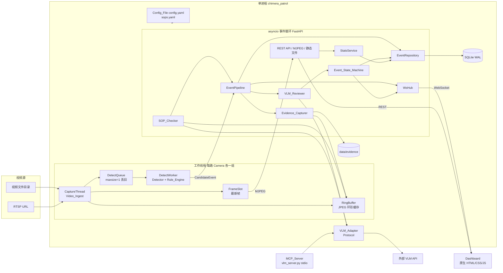
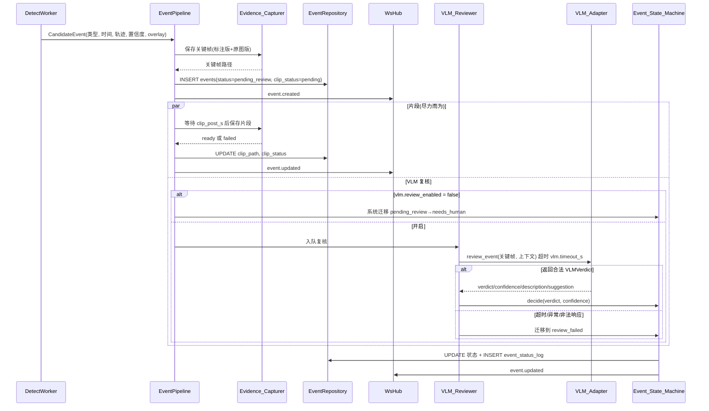
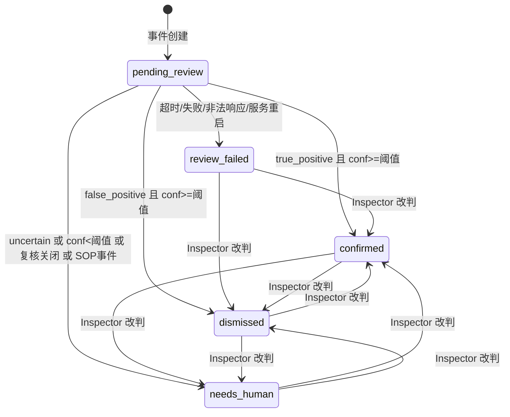

# 设计文档

## Overview

Chimera Patrol 是面向工业/能源场站的多路视频智能巡检工具。本设计覆盖 requirements.md 中的全部 13 项需求，采用 **Python 3.11+ / FastAPI / SQLite 的单进程单体**架构，前端为原生 HTML/CSS/JS（MJPEG 视频流 + WebSocket 事件推送），不使用消息队列、微服务、前端框架或构建链。

核心链路：

```
Video_Ingest → Detector(YOLO + 跟踪) → Rule_Engine(ROI/规则) → Evidence_Capturer
            → 事件落库(SQLite) → VLM_Reviewer(经 VLM_Adapter 异步复核) → Event_State_Machine
            → WebSocket 推送 → Dashboard / Stats_Panel
```

### 调研结论（影响设计的要点）
> **2026 变更（任务 3.2）**：supervision 0.31.5 已移除 sv.ByteTrack（官方 0.31.0 迁移指南）。跟踪改用独立包 `trackers==2.7.0 的 ByteTrackTracker，supervision==0.31.5 仅用于 Detections 数据结构。每路 Camera 仍持有独立跟踪器实例，lost_buffer_s 换算为 30 FPS 单位的 lost_track_buffer。

| 主题 | 结论 | 设计影响 |
|---|---|---|
| Ultralytics `model.track(persist=True)` | 跟踪器状态绑定在 predictor 上，多路共享同一个 model 实例会串 ID | 权重只加载一份，推理用 `predict`（加锁共享）；每路 Camera 持有独立的 ByteTrack 实例（`trackers.ByteTrackTracker`（2026 变更，见上方说明）） |
| MJPEG | `multipart/x-mixed-replace; boundary=frame` 即可被 `` 直接播放，无需前端库 | `/api/cameras/{id}/stream.mjpg` 用异步生成器输出，JPEG 编码放线程池 |
| FastAPI WebSocket | 原生支持，单进程内用 `set[WebSocket]` 做广播即可 | `WsHub` 在事件循环内广播；工作线程通过 `run_coroutine_threadsafe` 投递 |
| SQLite | WAL 模式支持单写多读，足以支撑演示级并发 | 单连接写入 + 写锁，读使用独立只读连接，均经 `asyncio.to_thread` 调用 |
| MCP（Model Context Protocol） | 官方 Python SDK 的 `FastMCP` 可用 stdio 暴露工具；Kiro 通过工作区 `.kiro/settings/mcp.json` 加载 | VLM_Adapter 同一份实现既被应用进程内调用，也被 MCP server 包装为工具 |
| 浏览器视频播放 | `cv2.VideoWriter` 的 `mp4v` 编码浏览器通常无法播放 | 片段用 `imageio-ffmpeg`（自带 ffmpeg 二进制）以 H.264/yuv420p 编码 |

### 已定设计决策（用户确认，最终）

| 编号 | 决策 | 落点 |
|---|---|---|
| D1 | 安全帽检测使用独立的 **work_zone** 区域，与闯入区域共用多边形机制，以 `type` 区分（`intrusion` \| `work_zone`）。某 Camera 未配置 work_zone 时，安全帽规则对**全画面每个 person** 生效 | 配置 `cameras[].rois[].type`、Rule_Engine 的 `HelmetRule` |
| D2 | “关联安全帽”按 person 框**顶部头部区域**与 helmet 框的重叠判定。头部区域 = person 框自顶向下 `head_region_ratio`（默认 0.25）高度、与 person 框同宽的矩形；重叠度量默认 **IoH**（交集面积 / helmet 框面积），阈值 `assoc_overlap_threshold` 默认 0.5，度量可切换为 `iou` | 配置 `rules.helmet.*` |
| D3 | 未佩戴安全帽 5 秒计时**对每个 person track 连续计算**：窗口内任一已处理帧检测到关联安全帽即清零 | `HelmetTimer` |
| D4 | 烟火“连续 3 个已处理帧”要求**同一位置**：相邻已处理帧的检测框 IoU 高于 `same_spot_iou_threshold` 才算同一处；未命中或不重叠则中断连续计数 | `SmokeFireTracker` |
| D5 | 烟火置信度阈值与未佩戴安全帽置信度阈值为**两个独立配置项**，默认均为 0.5 | `rules.smoke_fire.conf_threshold`、`rules.helmet.conf_threshold` |

### 设计假设（需求未明确处，设计默认值，均已说明是否可配置）

| 编号 | 假设 | 可配置 |
|---|---|---|
| A1 | 区域闯入/滞留/安全帽区域判定使用 person 框的**底边中点**（脚点）作为参考点 | `rules.reference_point`：`bottom_center` \| `center` |
| A2 | SOP 采样 8 帧时，时间窗口**两端点均取到**：`t_i = T-5 + i·10/7`（i=0..7）。若关闭则取 8 个等分子区间的中点 | `sop.endpoints_inclusive` |
| A3 | ROI 坐标使用**归一化坐标**（0~1，相对画面宽高），只在 Config_File 中配置（改后重启生效）；Dashboard 只读叠加显示，不提供在线绘制 | 否 |
| A4 | 帧时间戳取采集时刻的 UTC 毫秒时间；文件源按源 fps 节拍播放（保持实时速度）；视频循环重启时重置该路 tracker 与全部规则状态（含冷却表） | 否 |
| A5 | 数据库与 API 的时间字段统一为 **UTC 毫秒整数**，字段名以 `_ms` 结尾 | 否 |
| A6 | 统计默认**不含** `sop_violation`（它不是 CV 报警），可用 `include_sop=true` 纳入；分桶与总数使用同一过滤口径 | 查询参数 |
| A7 | SOP 事件创建时已由 SOP_Checker 的 VLM 判定过，状态机先置 `pending_review`，随即由系统迁移到 `needs_human`（不再二次调用 VLM） | 否 |
| A8 | 关键帧取事件 `[start_ms, end_ms]` 中点最近的帧；短片段取 `[end_ms - clip_pre_s, end_ms + clip_post_s]`（默认前 3 秒后 3 秒，合计约 6 秒） | `evidence.clip_pre_s/clip_post_s` |
| A9 | 无认证体系，改判人通过请求体 `operator`（1~32 字符字符串）声明，仅用于留痕 | 否 |
| A10 | 服务重启时：遗留的 `pending_review` 事件置为 `review_failed`（原因 `service_restart`），遗留的 `running` SOP 检查置为 `check_failed_retry`，保证不丢失 | 否 |
| A11 | 应用运行时**进程内**直接调用 VLM_Adapter；MCP server 是同一适配实现的另一个入口，用于 Kiro 编排与演示 | 否 |
| A12 | 自动判定置信度阈值 0.7 暴露为配置项 | `vlm.auto_decision_threshold` |
| A13 | “待人工数” = `needs_human` + `review_failed`（后者按需求 5.5 属于人工队列），同时单独给出两者计数 | 否 |
| A14 | 误报下降率在 `total_alarms = 0` 时返回 `null`（前端显示“—”），不返回 0 | 否 |
| A15 | SOP 的 VLM 返回缺失某步骤时，该步骤补为 `unknown`；JSON 结构非法或 status 非枚举值，视为 VLM 失败，整次检查为“检查失败待重试” | 否 |
| A16 | SOP 检查沿用 `vlm.timeout_s`（需求 11.9）。8 帧请求耗时可能高于单帧复核，演示时若超时可调大该值 | 沿用 |

## Architecture

### 组件图



### 线程与异步模型

| 执行体 | 数量 | 职责 | 不阻塞保证 |
|---|---|---|---|
| asyncio 主循环（uvicorn） | 1 | REST、WebSocket、MJPEG、EventPipeline、VLM_Reviewer、SOP_Checker 调度 | 所有阻塞操作（DB、磁盘、JPEG/视频编码）通过 `asyncio.to_thread` 或专用线程池 |
| CaptureThread | 每路 Camera 1 个 | 读帧、按源 fps 节拍、写 `FrameSlot`、写 `RingBuffer`、按抽帧间隔向 `DetectQueue` 投帧 | 只做读取与轻量编码，不做推理 |
| DetectWorker | 每路 Camera 1 个 | 取 `DetectQueue` 的帧，运行 Detector 与 Rule_Engine，产出 `CandidateEvent` | `DetectQueue(maxsize=1)` 满时丢弃旧帧，推理慢只会降低处理帧率，不会拖慢采集与显示（需求 2.4） |
| DB 写入 | 经 `asyncio.to_thread` + 写锁 | 串行化写入 | WAL 允许读写并行 |
| VLM 复核任务 | 并发上限 `vlm.max_concurrency` | `asyncio.wait_for(adapter.review_event(...), vlm.timeout_s)` | 与检测线程完全解耦（需求 5.7） |
| 片段编码任务 | 线程池 | 等待 post-roll 后快照环形缓存并编码 H.264 | 失败仅记录日志（需求 4.3） |

要点：

1. **YOLO 权重共享**：person、smoke/fire、helmet 三份权重各加载一次，推理方法 `predict` 用 `threading.Lock` 串行化；每路 Camera 持有独立 `ByteTrack`（仅对 person 跟踪）。
2. **MJPEG 与检测解耦**：流端点读取 `FrameSlot` 中的最新原始帧，叠加 DetectWorker 最近一次发布的检测框（`overlay=1` 时），在线程池中 `cv2.imencode`，因此检测延迟不影响画面流畅度。
3. **线程到事件循环**：DetectWorker 通过 `asyncio.run_coroutine_threadsafe(pipeline.submit(candidate), loop)` 投递事件；投递失败仅记录日志。
4. **时间基准**：见假设 A4，所有规则时长使用已处理帧的时间戳差，不依赖墙钟 `sleep`。

### 事件数据流



### 事件状态机



规则：

- 系统迁移只能从 `pending_review` 发起。
- Inspector 改判的目标状态只能是 `confirmed`、`dismissed`、`needs_human`；`pending_review` 状态的事件不可改判（复核在途，返回 409）；目标与当前状态相同返回 409。
- 每次迁移（系统或人工）都写一条 `event_status_log`；`dismissed` 事件仍保留在事件列表中（需求 6.5）。

### Rule_Engine 规则设计

每路 Camera 一个 `RuleEngine` 实例，状态仅由该路已处理帧驱动。输入为 `FrameResult{ts_ms, frame_index, persons[{track_id, box, conf}], smoke_fire[{label, box, conf}], helmets[{kind: helmet|no_helmet, box, conf}]}`。

**几何基础（纯函数）**

- `ref_point(box)`：`bottom_center = ((x1+x2)/2, y2)`；`center = ((x1+x2)/2, (y1+y2)/2)`（A1）。
- `point_in_polygon(point, polygon)`：射线法，边界视为在内。
- `iou(a,b)`、`ioh(helmet, head) = area(helmet∩head)/area(helmet)`（helmet 面积为 0 时为 0）。
- `head_region(person_box, ratio) = (x1, y1, x2, y1 + ratio·(y2−y1))`。

**区域闯入（3.2）**：对每个 person track，维护其是否在某 `intrusion` ROI 内。已处理帧中参考点从“不在任何该 ROI 内”变为“在 ROI 内”时产生一条 `intrusion` 事件（`start_ms = end_ms` = 该帧时间）。离开 ROI 超过 `roi_exit_grace_s` 才视为离开，因此抖动不会重复触发；再次进入是否报警由冷却决定。

**人员滞留（3.3）**：同一 track 在同一 ROI 内**连续**停留（容忍 `roi_exit_grace_s` 内的短暂检测缺失）时长 `≥ dwell_threshold_s` 时产生一条 `loitering` 事件（`start_ms` = 进入时间，`end_ms` = 触发帧时间）。一次连续停留只触发一次，离开后重置。

**烟火（3.4，D4/D5）**：`SmokeFireTracker` 维护若干“点位” `Spot{label, last_box, streak, fired}`。每个已处理帧：

1. 仅保留 `conf ≥ smoke_fire.conf_threshold` 的检测；
2. 将检测与已有点位按相同 `label` 且 `IoU ≥ same_spot_iou_threshold` 做贪心匹配（IoU 降序，一对一）；
3. 匹配成功：`streak += 1`，更新 `last_box`；未匹配的点位**删除**（连续被中断）；未匹配的检测新建点位 `streak = 1`；
4. 点位 `streak ≥ consecutive_frames` 且未 `fired` 时产生一条 `smoke_fire` 事件并标记 `fired`（`start_ms` = 连续段首帧时间，`end_ms` = 当前帧时间；`cv.detail.label` 记录 smoke/fire）。

**安全帽（3.5~3.8，D1/D2/D3/D5）**：

1. **作用域**：该 Camera 有 `work_zone` 时，仅参考点落在任一 work_zone 内的 person 参与；无 work_zone 时全画面所有 person 参与（D1）。高度小于 `min_person_height_px` 的 person 忽略（头部区域过小不可靠）。
2. **关联**：只采纳 `conf ≥ helmet.conf_threshold` 的 helmet 检测。对作用域内 person 与 helmet 计算 `overlap(helmet, head_region(person))`，度量由 `assoc_overlap_metric` 决定（`ioh` 或 `iou`），`≥ assoc_overlap_threshold` 的配对为候选；按重叠度降序做**一对一贪心分配**（一个 helmet 至多关联一个 person）。
3. **违规帧**：person 在已处理帧中无关联 helmet 即为违规帧。若 `require_no_helmet_evidence = true`，还要求头部区域内存在 `conf ≥ 阈值` 的 no_helmet 检测框才算违规帧，否则视为非违规（保守，默认关闭）。
4. **计时（D3）**：`HelmetTimer` 以 track 为单位；首个违规帧记录 `t0`；之后每个已处理帧：违规则保持，**关联到安全帽则清零**；当 `ts - t0 ≥ no_helmet_duration_s` 产生 `no_helmet` 事件（`start_ms=t0`，`end_ms=ts`，`detection_source=yolo`）。track 连续 `track_gap_reset_s` 未出现、或离开作用域超过 `roi_exit_grace_s`，计时器清零。一次连续违规只触发一次。
5. **VLM 兜底（3.7）**：`helmet.vlm_fallback.enabled` 且 `vlm.review_enabled` 同时为真时，对作用域内每个 track 每隔 `interval_s` 秒裁剪头部区域（按 `crop_padding_ratio` 外扩）调用 `VLM_Adapter.check_helmet_crop`。返回“未佩戴”且 `confidence ≥ min_confidence` 时产生 `no_helmet` 事件，`detection_source=vlm_fallback`，`start_ms = end_ms` = 检查时间，`cv_confidence` 取 VLM 返回置信度。兜底检查异步执行；其失败只记日志，不产生事件。
6. **同一流程（3.8）**：两条路径产出的事件都以 `pending_review` 进入同一 EventPipeline，之后用关键帧做同样的 VLM 复核；状态机决策不读取 `detection_source`。

**冷却去重（3.9）**：`CooldownTable` 以键 `(event_type, target_key)` 记录上次触发时间。`target_key`：person 类事件为 `track:{track_id}`（权重与兜底路径共用同一键），烟火为点位（与上次事件框 IoU ≥ `same_spot_iou_threshold` 视为同一点位，记录最近事件框）。`ts - last < cooldown_s` 时丢弃并记 debug 日志。SOP 事件由人工触发，不做冷却。

**轨迹记录（3.10）**：每个 track 保留 `(ts_ms, x1,y1,x2,y2)`，事件中记录触发前窗口内的轨迹，超过 `trajectory_max_points` 时等距下采样（保留首尾点）。

### 视频接入（Video_Ingest）

- 启动时扫描 `video.source_dir` 中扩展名在 `video.file_extensions` 内的文件，按文件名排序，取前 `video.max_cameras` 个；Camera ID 默认为**文件名主干**（如 `intrusion_real.mp4` → `intrusion_real`）。
- `cameras[]` 中 `id` 与文件主干匹配的条目用于覆盖 `name`、`rtsp_url`、`rois`；填了 `rtsp_url` 则该 Camera 使用 RTSP 源替代文件源（需求 1.3）；`id` 无对应文件但有 `rtsp_url` 的条目创建纯 RTSP Camera（仍受 `max_cameras` 约束）。
- 文件源读到末尾自动回绕（`video.loop`），并通知 Detector/Rule_Engine 重置（A4）。
- 读帧连续失败 `video.offline_after_failures` 次，将该路置为 `offline`（`camera.status` 推送），之后每 `video.reconnect_interval_s` 秒重试；任何一路的失败都不影响其他路（需求 1.2、12.4）。
- 发现的可用 Camera 少于 2 路仅记 warning，不阻止启动。

### 证据截取（Evidence_Capturer）

- `RingBuffer` 每路保存最近 `evidence.ring_buffer_s` 秒、至多 `evidence.ring_fps` 帧/秒的 JPEG（质量 `ring_jpeg_quality`）及其时间戳。`snapshot(from_ms, to_ms)` 返回时间范围内的帧记录。
- **关键帧（4.1）**：`select_frame(frames, mid_ms)` 选时间戳最接近 `mid_ms = (start_ms+end_ms)/2` 的帧；原图版取自该 JPEG，标注版在其上绘制 `CandidateEvent.overlay`（检测框、label、conf、相关 ROI 多边形）。
- **短片段（4.2、4.3）**：事件创建后等待 `clip_post_s` 秒，快照 `[end_ms-clip_pre_s, end_ms+clip_post_s]`，用 `imageio-ffmpeg` 以 H.264 写出 `clip.mp4`。成功则 `clip_status=ready`，失败记录错误日志并置 `clip_status=failed`，事件流转不受影响。SOP 事件的片段在 SOP 采样结束时从同一快照裁出（避免 VLM 耗时导致缓存过期）。
- 存储路径：`{evidence.base_dir}/{camera_id}/{event_id}/keyframe_annotated.jpg|keyframe_raw.jpg|clip.mp4`；数据库只存相对 `base_dir` 的路径，HTTP 通过 `/media/{相对路径}` 提供。

### VLM 复核层

**VLM_Adapter 接口（Python `Protocol`，全部为 async）**

```python
class VLMAdapter(Protocol):
    async def review_event(self, req: ReviewRequest) -> VLMVerdict: ...
    async def check_sop(self, req: SopCheckRequest) -> SopCheckResult: ...
    async def check_helmet_crop(self, req: HelmetCropRequest) -> HelmetCropResult: ...
```

- 实现：`OpenAICompatibleAdapter`（`httpx.AsyncClient`，OpenAI 兼容 chat completions，图片以 base64 data URL 传递，要求只返回 JSON）与 `MockAdapter`（确定性返回，用于测试与离线演示）。更换 VLM 提供方只需新增实现并修改 `vlm.provider`（需求 5.3）。
- **规范化（需求 5.2）**：适配层负责把原始文本解析为 `VLMVerdict`：去除代码围栏后解析 JSON；`verdict ∈ {true_positive, false_positive, uncertain}`；`confidence` 为 [0,1] 内的数；`description` 去首尾空白后若超过 `vlm.description_max_chars` 则截断，为空则判为非法；`suggestion` 缺失时为空串。任何不合规都抛 `VLMResponseError`，由调用方视为失败。
- **超时（需求 5.5）**：调用方统一用 `asyncio.wait_for(..., vlm.timeout_s)`；适配层不做自动重试（`max_retries` 默认 0），以保证总耗时受 `timeout_s` 约束。
- **日志（需求 12.6）**：记录请求摘要（事件 ID、类型、图片字节数）与响应摘要（verdict、confidence、耗时），不记录图片内容与 API Key。
- **并发**：`asyncio.Semaphore(vlm.max_concurrency)` 限制同时在途请求数，多余事件保持 `pending_review` 排队。

**MCP 登记（需求 5.4、13.4）**：`chimera_patrol/mcp/vlm_server.py` 用 `FastMCP` 通过 stdio 暴露 `review_event`、`check_sop`、`check_helmet_crop` 三个工具，内部复用同一 `build_adapter(config)`。在 `.kiro/settings/mcp.json` 登记：

```json
{
  "mcpServers": {
    "chimera-vlm": {
      "command": "python",
      "args": ["-m", "chimera_patrol.mcp.vlm_server", "--config", "config.yaml"],
      "env": { "VLM_API_KEY": "${VLM_API_KEY}" },
      "disabled": false,
      "autoApprove": ["review_event", "check_helmet_crop"]
    }
  }
}
```

**复核提示词要点**：中文；给出事件类型、摄像头名、区域名、CV 置信度；要求仅输出 JSON：`{"verdict": "...", "confidence": 0.0, "description": "一句话中文描述", "suggestion": "处置建议"}`，并告知 description 不超过 `description_max_chars` 个字符。

### SOP_Checker

1. **触发**：`POST /api/sop/runs`（`sop_id`、`camera_id`、`operator`）。校验 SOP 存在、适用于该 Camera（`camera_ids` 含该 ID 或为 `["*"]`）、Camera 在线、同一 Camera 无进行中的检查。立即返回 202 与 `running` 的 SopRun。
2. **采样**：触发时刻 `T`，窗口 `[T - window_before_s, T + window_after_s]`。后台任务等到 `T + window_after_s` 后，按 `sample_times(T, before, after, n, inclusive)`（A2）计算 `n = sample_count` 个时间点，从 `RingBuffer` 取最近邻帧；同时快照窗口内的帧供片段使用。若一帧都取不到，则整次检查失败（原因 `no_frames`）。
3. **判定**：把采样帧（按时间排序，带序号与时间戳）与 SOP 步骤清单发送 `check_sop`；每步返回 `status`（`pass|fail|unknown`）、`evidence`、可选 `evidence_frame`（帧序号）。
4. **结果归一**：补全缺失步骤为 `unknown`（A15）；`approximate = step.requires_sequence`（需求 11.8，由 sops.yaml 定义，示例 SOP 默认均为 false）。
5. **结局（需求 11.6、11.9、11.10）**：
   - 成功且存在任一 `fail`：SopRun 置 `completed`，创建一条 `sop_violation` 事件（含失败步骤与关键帧，关键帧取首个失败步骤的 `evidence_frame`，缺省取中间采样帧），状态按 A7 进入 `needs_human`；
   - 成功且无 `fail`：`completed`，不产生事件；
   - VLM 超时/失败/响应非法/无帧：SopRun 置 `check_failed_retry` 并写入 `failure_reason`；**不创建事件，不写入任何步骤的 `fail`**（步骤结果表为空）；Inspector 可再次 `POST /api/sop/runs`（带 `retry_of`）重新触发。
6. 采样帧另存为 `{base_dir}/sop/{run_id}/frame_{i}.jpg` 供追溯。

### 前端（Dashboard）

静态文件由 FastAPI `StaticFiles` 提供，无构建步骤：

```
web/
  index.html        首页：视频墙 + 事件流 + 筛选 + Stats_Panel + SOP 面板入口
  event.html        事件详情页（?id=evt_xxx）：回放区 | CV 判定区 | VLM 判定区 三栏并排
  css/app.css
  js/api.js         fetch 封装
  js/ws.js          WebSocket 连接、自动重连（指数退避，重连后重新拉取事件列表）
  js/wall.js        视频墙：、状态、角标、ROI 叠加
  js/events.js      事件流（新事件置顶）与筛选
  js/detail.js      详情页与改判
  js/stats.js       Stats_Panel，导出按钮
  js/sop.js         SOP 检查面板，步骤亮灯
```

- 事件流：收到 `event.created` 置顶插入，`event.updated` 按 `id` 更新；每条显示类型、时间与 CV/VLM 两层徽标（VLM 徽标取值：`未复核`、`true_positive`、`false_positive`、`uncertain`、`复核失败`、`复核关闭`）。
- 视频墙每路含：MJPEG 画面、在线/离线状态、该路最近事件角标（来自 `GET /api/cameras` 的 `latest_event` 与 WS 更新）。
- SOP 面板：每步一个指示灯（pass 绿、fail 红、unknown 灰），旁显依据；`approximate=true` 的步骤加“近似判定”标注；`check_failed_retry` 时显示失败原因与“重新检查”按钮。

### 目录结构

```
chimera-patrol/
  config.yaml            带注释的示例配置（随仓库发布）
  config.demo.yaml       演示配置（--demo 使用）
  sops.yaml              含示例 SOP「入场作业准备」
  samples/videos/        至少 2 段样例视频（含真事件 / 含典型误报）
  web/                   前端静态文件
  chimera_patrol/
    __main__.py          入口：python -m chimera_patrol [--demo] [--config PATH]
    config.py            pydantic 配置模型 + 校验
    ingest/              Video_Ingest、RingBuffer
    detect/              Detector、tracker、FrameResult
    rules/               geometry、RuleEngine、HelmetRule、SmokeFireTracker、Cooldown
    evidence/            Evidence_Capturer
    vlm/                 VLMAdapter、OpenAI 兼容实现、Mock、normalize
    review/              VLM_Reviewer、Event_State_Machine
    sop/                 SOP 加载、采样、SOP_Checker
    store/               schema.sql、EventRepository
    api/                 routes、ws hub、stats、export
    mcp/vlm_server.py
  tests/
  .kiro/{specs,steering,hooks,settings/mcp.json}
```

## Components and Interfaces

### 核心内部类型

```python
EventType = Literal["intrusion", "loitering", "smoke_fire", "no_helmet", "sop_violation"]
EventStatus = Literal["pending_review", "confirmed", "dismissed", "needs_human", "review_failed"]
DetectionSource = Literal["yolo", "vlm_fallback", "sop"]

@dataclass
class CandidateEvent:
    camera_id: str
    event_type: EventType
    detection_source: DetectionSource
    start_ms: int
    end_ms: int
    cv_confidence: float | None      # sop_violation 为 None
    track_id: int | None
    roi_id: str | None
    detail: dict                     # label、boxes、规则参数快照等
    trajectory: list[list[float]]    # [[ts_ms,x1,y1,x2,y2], ...]
    overlay: list[OverlayItem]       # 关键帧标注用
    sop_run_id: str | None = None

@dataclass
class VLMVerdict:
    verdict: Literal["true_positive", "false_positive", "uncertain"]
    confidence: float                # 0..1
    description: str                 # 1..description_max_chars
    suggestion: str
```

### 关键接口（签名）

| 组件 | 接口 | 说明 |
|---|---|---|
| `geometry` | `ref_point`、`point_in_polygon`、`iou`、`ioh`、`head_region` | 纯函数 |
| `RuleEngine` | `process(frame_result) -> list[CandidateEvent]` | 每路一个实例，含闯入/滞留/烟火/安全帽/冷却 |
| `associate_helmets` | `(persons, helmets, ratio, metric, threshold, conf_threshold) -> dict[track_id, helmet_idx]` | 纯函数，一对一贪心 |
| `select_processed(frame_index, n)` | `frame_index % n == 0` | 抽帧判断 |
| `sample_times` | `(T, before_s, after_s, n, inclusive) -> list[int]` | SOP 采样时刻 |
| `decide_status` | `(verdict, confidence, threshold) -> EventStatus` | 复核结果到状态 |
| `can_transition` | `(from, to, actor_type) -> bool` | 迁移合法性 |
| `normalize_vlm_response` | `(raw_text, max_chars) -> VLMVerdict` | 失败抛 `VLMResponseError` |
| `compute_stats` | `(events, include_sop) -> Stats` | 统计口径（纯函数，SQL 查询的参考实现） |
| `EventRepository` | `insert_event`、`get_event`、`list_events(filters)`、`transition(event_id, to, actor, reason)`、`update_evidence`、`stats(filters)` | SQLite 访问 |
| `EventPipeline` | `submit(candidate)` | 取证→落库→推送→片段→复核 |
| `WsHub` | `broadcast(type, data)` | 带递增 `seq` |

### HTTP API

约定：所有 JSON 响应 `Content-Type: application/json`；时间字段统一 `*_ms`（UTC 毫秒）；错误统一为

```json
{ "error": { "code": "not_found", "message": "event evt_xxx not found" } }
```

错误码：`not_found`(404)、`validation_error`(422)、`invalid_transition`(409)、`camera_offline`(409)、`run_in_progress`(409)、`sop_not_applicable`(422)、`internal_error`(500)。

#### EventDTO（列表、详情、WS 共用）

```json
{
  "id": "evt_3f9a1c2b7d10",
  "camera_id": "intrusion_real",
  "camera_name": "东门通道",
  "event_type": "intrusion",
  "detection_source": "yolo",
  "status": "pending_review",
  "start_ms": 1790000000000,
  "end_ms": 1790000000000,
  "cv": {
    "confidence": 0.87,
    "track_id": 12,
    "roi_id": "gate_zone",
    "roi_type": "intrusion",
    "detail": { "label": "person", "box": [120, 80, 220, 400], "reference_point": "bottom_center" },
    "trajectory": [[1789999999000, 100, 80, 200, 400]]
  },
  "evidence": {
    "keyframe_annotated_url": "/media/intrusion_real/evt_3f9a1c2b7d10/keyframe_annotated.jpg",
    "keyframe_raw_url": "/media/intrusion_real/evt_3f9a1c2b7d10/keyframe_raw.jpg",
    "clip_url": null,
    "clip_status": "pending"
  },
  "vlm": null,
  "sop": null,
  "created_ms": 1790000000100,
  "updated_ms": 1790000000100
}
```

- `cv.trajectory` 仅在详情接口返回；列表与 WS 中省略该字段。
- `vlm`：未复核时为 `null`；复核后为 `{ "verdict": "false_positive", "confidence": 0.91, "description": "...", "suggestion": "...", "reviewed_ms": 1790000003000, "error": null, "skipped": false }`；复核关闭时为 `{ "verdict": null, "confidence": null, "description": null, "suggestion": null, "reviewed_ms": null, "error": null, "skipped": true }`；失败时 `error` 为失败原因字符串（如 `timeout`、`response_invalid`、`service_restart`）。
- `sop`：仅 `sop_violation` 事件非空：`{ "run_id": "sop_...", "sop_id": "entry_prep", "failed_steps": [{ "step_id": "wear_gloves", "description": "...", "evidence": "..." }] }`。
- 详情接口额外返回 `status_log: [{ "from_status", "to_status", "actor_type", "actor", "reason", "created_ms" }]`。

#### 端点清单

| 方法 | 路径 | 参数 | 响应 |
|---|---|---|---|
| GET | `/api/health` | 无 | `{ "status": "ok", "vlm_review_enabled": true, "version": "..." }` |
| GET | `/api/cameras` | 无 | `{ "items": [CameraDTO] }`（每路含 `paused`） |
| POST | `/api/cameras/{camera_id}/pause` | 无 | `{ "camera_id", "paused": true }`；Camera 不存在 404。只停止检测与报警，视频流与在途 VLM 复核不受影响；状态只存内存，进程重启后全部为运行 |
| POST | `/api/cameras/{camera_id}/resume` | 无 | `{ "camera_id", "paused": false }`；Camera 不存在 404。恢复后下一帧前清空该路跟踪与规则状态 |
| GET | `/api/config/effective` | 无 | 当前生效配置的只读视图：每路摄像头的检测阈值、ROI、冷却时间，规则全局参数，VLM 的提供方、模型、接口地址、超时与复核开关。API Key 只返回 `api_key.configured`（是否已设置）与环境变量名，绝不返回取值 |
| GET | `/api/cameras/{camera_id}/stream.mjpg` | query：`overlay`(bool，默认 true，叠加检测框与 ROI)、`fps`(1~30，默认 `video.mjpeg.fps`) | `multipart/x-mixed-replace; boundary=frame`；Camera 不存在 404 |
| GET | `/api/events` | query：`camera_id`、`event_type`、`status`（三者均支持逗号分隔多值）、`from_ms`、`to_ms`、`limit`(1~200，默认 50)、`offset`(≥0，默认 0) | `{ "items": [EventDTO], "total": 123, "limit": 50, "offset": 0 }`，按 `created_ms DESC, id DESC` |
| GET | `/api/events/{event_id}` | 无 | EventDTO（含 `trajectory`、`status_log`）；404 |
| POST | `/api/events/{event_id}/status` | body：`{ "to_status": "confirmed\|dismissed\|needs_human", "operator": "张三", "reason": "可选，≤200字符" }` | 更新后的 EventDTO；404/409/422 |
| GET | `/api/stats` | query：`camera_id`、`from_ms`、`to_ms`、`include_sop`(默认 false) | StatsDTO |
| GET | `/api/stats/export` | 同 `/api/stats` 的 query + `format=json\|csv`（默认 json） | 带 `Content-Disposition: attachment` 的文件 |
| GET | `/api/sops` | 无 | `{ "items": [{ "id", "name", "camera_ids", "steps": [{ "id", "description", "criteria", "requires_sequence" }] }] }` |
| POST | `/api/sop/runs` | body：`{ "sop_id": "entry_prep", "camera_id": "xxx", "operator": "张三", "retry_of": "sop_...(可选)" }` | 202 + SopRunDTO(`status=running`)；404/409/422。`retry_of` 必须指向 `check_failed_retry` 的 run，否则 422 |
| GET | `/api/sop/runs/{run_id}` | 无 | SopRunDTO；404 |
| GET | `/api/sop/runs` | query：`camera_id`、`status`、`limit`(默认 20) | `{ "items": [SopRunDTO] }`，按 `created_ms DESC` |
| GET | `/media/{path}` | 证据文件（静态） | 文件；路径经规范化，禁止越出 `evidence.base_dir` |
| GET | `/`、`/static/*` | 前端静态文件 | HTML/CSS/JS |

**CameraDTO**

```json
{
  "id": "intrusion_real", "name": "东门通道",
  "source_type": "file", "status": "online", "status_changed_ms": 1790000000000, "paused": false,
  "stream_url": "/api/cameras/intrusion_real/stream.mjpg",
  "rois": [{ "id": "gate_zone", "type": "intrusion", "name": "东门禁入区", "polygon": [[0.1,0.2],[0.8,0.2],[0.8,0.9],[0.1,0.9]] }],
  "latest_event": { "id": "evt_...", "event_type": "intrusion", "status": "confirmed", "created_ms": 1790000000100 },
  "event_counts": { "total": 5, "pending_human": 1 }
}
```

`latest_event` 无事件时为 `null`；`source` 中的 RTSP 凭据不对外返回。

**SopRunDTO**

```json
{
  "id": "sop_a1b2c3d4e5f6", "sop_id": "entry_prep", "sop_name": "入场作业准备",
  "camera_id": "intrusion_real",
  "status": "completed",
  "triggered_ms": 1790000100000, "window_start_ms": 1790000095000, "window_end_ms": 1790000105000,
  "sample_count": 8, "sample_times_ms": [1790000095000, 1790000096428],
  "failure_reason": null, "retry_of": null, "operator": "张三",
  "steps": [
    { "index": 0, "step_id": "wear_helmet", "description": "佩戴安全帽", "status": "pass", "evidence": "…", "approximate": false }
  ],
  "event_id": "evt_...", "created_ms": 1790000100000, "finished_ms": 1790000112000
}
```

`status ∈ running | completed | check_failed_retry`；`check_failed_retry` 时 `steps` 为 `[]`、`failure_reason` 非空（如 `vlm_timeout`、`vlm_error`、`response_invalid`、`no_frames`、`service_restart`）、`event_id` 为 `null`。

**StatsDTO**

```json
{
  "generated_ms": 1790000200000,
  "filters": { "camera_id": null, "from_ms": null, "to_ms": null, "include_sop": false },
  "totals": {
    "total_alarms": 20, "confirmed": 6, "dismissed": 9, "needs_human": 3, "review_failed": 1, "pending_review": 1,
    "pending_human": 4, "false_positive_reduction_rate": 0.45
  },
  "by_camera": [{ "camera_id": "cam_a", "total_alarms": 10, "confirmed": 3, "dismissed": 5, "needs_human": 1, "review_failed": 0, "pending_review": 1, "pending_human": 1, "false_positive_reduction_rate": 0.5 }],
  "by_type":   [{ "event_type": "intrusion", "total_alarms": 8, "confirmed": 2, "dismissed": 4, "needs_human": 1, "review_failed": 0, "pending_review": 1, "pending_human": 1, "false_positive_reduction_rate": 0.5 }]
}
```

口径：`total_alarms` = 过滤范围内事件总数 = `confirmed + dismissed + needs_human + review_failed + pending_review`；`pending_human = needs_human + review_failed`；`false_positive_reduction_rate = dismissed / total_alarms`，`total_alarms = 0` 时为 `null`；`by_camera` 与 `by_type` 各自的各计数之和等于 `totals`。

CSV 导出表头：`dimension,key,total_alarms,confirmed,dismissed,needs_human,review_failed,pending_review,pending_human,false_positive_reduction_rate`，`dimension ∈ total | camera | event_type`；`total` 行的 `key` 为空；比率为 null 时该单元格留空。

### WebSocket 协议

端点：`GET /ws/events`（WebSocket，无参数）。所有消息为 JSON 文本帧，统一信封：

```json
{ "type": "event.created", "seq": 128, "ts_ms": 1790000000200, "data": { } }
```

`seq` 为进程内单调递增整数。服务端→客户端消息：

| type | data | 触发 |
|---|---|---|
| `hello` | `{ "server_time_ms": 1790000000000, "vlm_review_enabled": true, "heartbeat_interval_s": 15 }` | 连接建立后立即发送 |
| `event.created` | EventDTO（无 `trajectory`） | 事件落库后 |
| `event.updated` | EventDTO（无 `trajectory`） | 状态变化、VLM 结果写入、片段就绪/失败、人工改判 |
| `camera.status` | `{ "camera_id": "...", "status": "online\|offline", "status_changed_ms": 1790000000000 }` | Camera 上线/离线 |
| `sop.run.updated` | SopRunDTO | SOP 检查状态变化 |
| `heartbeat` | `{}` | 每 `ws.heartbeat_interval_s` 秒 |

客户端→服务端仅支持 `{ "type": "ping" }`，服务端回复 `{ "type": "pong", ... }`；其他消息被忽略。断线重连后客户端不依赖补发，而是重新调用 `GET /api/events`、`GET /api/cameras` 对账；客户端按事件 `id` 做 upsert，因此重复消息无副作用。

## Data Models

### SQLite DDL

连接初始化：`PRAGMA journal_mode=WAL; PRAGMA foreign_keys=ON; PRAGMA busy_timeout=5000;`。所有时间列为 UTC 毫秒整数。

```sql
CREATE TABLE IF NOT EXISTS cameras (
  id                TEXT PRIMARY KEY,
  name              TEXT NOT NULL,
  source_type       TEXT NOT NULL CHECK (source_type IN ('file','rtsp')),
  source            TEXT NOT NULL,                       -- 文件名或脱敏后的 RTSP 地址
  status            TEXT NOT NULL DEFAULT 'offline' CHECK (status IN ('online','offline')),
  status_changed_ms INTEGER NOT NULL
);

CREATE TABLE IF NOT EXISTS sop_runs (
  id               TEXT PRIMARY KEY,                     -- 'sop_' + 12 位十六进制
  sop_id           TEXT NOT NULL,
  sop_name         TEXT NOT NULL,
  camera_id        TEXT NOT NULL REFERENCES cameras(id),
  status           TEXT NOT NULL CHECK (status IN ('running','completed','check_failed_retry')),
  operator         TEXT NOT NULL,
  triggered_ms     INTEGER NOT NULL,
  window_start_ms  INTEGER NOT NULL,
  window_end_ms    INTEGER NOT NULL,
  sample_count     INTEGER NOT NULL CHECK (sample_count >= 1),
  sample_times_json TEXT NOT NULL DEFAULT '[]',          -- JSON 数组：各采样时刻 ms
  failure_reason   TEXT,
  retry_of         TEXT REFERENCES sop_runs(id),
  created_ms       INTEGER NOT NULL,
  finished_ms      INTEGER,
  CHECK (window_end_ms >= window_start_ms),
  CHECK ((status = 'check_failed_retry') = (failure_reason IS NOT NULL))
);
CREATE INDEX IF NOT EXISTS idx_sop_runs_camera_created ON sop_runs(camera_id, created_ms DESC);
CREATE INDEX IF NOT EXISTS idx_sop_runs_status ON sop_runs(status);
-- 同一 Camera 同时只允许一个 running
CREATE UNIQUE INDEX IF NOT EXISTS uq_sop_runs_running_per_camera ON sop_runs(camera_id) WHERE status = 'running';

CREATE TABLE IF NOT EXISTS sop_step_results (
  run_id      TEXT NOT NULL REFERENCES sop_runs(id) ON DELETE CASCADE,
  step_index  INTEGER NOT NULL CHECK (step_index >= 0),
  step_id     TEXT NOT NULL,
  description TEXT NOT NULL,
  status      TEXT NOT NULL CHECK (status IN ('pass','fail','unknown')),
  evidence    TEXT NOT NULL DEFAULT '',
  approximate INTEGER NOT NULL DEFAULT 0 CHECK (approximate IN (0,1)),
  PRIMARY KEY (run_id, step_id)
);

CREATE TABLE IF NOT EXISTS events (
  id                      TEXT PRIMARY KEY,              -- 'evt_' + 12 位十六进制
  camera_id               TEXT NOT NULL REFERENCES cameras(id),
  event_type              TEXT NOT NULL CHECK (event_type IN ('intrusion','loitering','smoke_fire','no_helmet','sop_violation')),
  detection_source        TEXT NOT NULL CHECK (detection_source IN ('yolo','vlm_fallback','sop')),
  status                  TEXT NOT NULL DEFAULT 'pending_review'
                          CHECK (status IN ('pending_review','confirmed','dismissed','needs_human','review_failed')),
  start_ms                INTEGER NOT NULL,
  end_ms                  INTEGER NOT NULL,
  cv_confidence           REAL CHECK (cv_confidence IS NULL OR (cv_confidence >= 0 AND cv_confidence <= 1)),
  track_id                INTEGER,
  roi_id                  TEXT,
  roi_type                TEXT CHECK (roi_type IS NULL OR roi_type IN ('intrusion','work_zone')),
  cv_detail_json          TEXT NOT NULL DEFAULT '{}',
  trajectory_json         TEXT NOT NULL DEFAULT '[]',    -- [[ts_ms,x1,y1,x2,y2],...]，≤ trajectory_max_points
  keyframe_annotated_path TEXT NOT NULL,                 -- 相对 evidence.base_dir
  keyframe_raw_path       TEXT NOT NULL,
  clip_path               TEXT,
  clip_status             TEXT NOT NULL DEFAULT 'pending' CHECK (clip_status IN ('pending','ready','failed')),
  vlm_verdict             TEXT CHECK (vlm_verdict IS NULL OR vlm_verdict IN ('true_positive','false_positive','uncertain')),
  vlm_confidence          REAL CHECK (vlm_confidence IS NULL OR (vlm_confidence >= 0 AND vlm_confidence <= 1)),
  vlm_description         TEXT,
  vlm_suggestion          TEXT,
  vlm_error               TEXT,
  vlm_reviewed_ms         INTEGER,
  review_skipped          INTEGER NOT NULL DEFAULT 0 CHECK (review_skipped IN (0,1)),
  sop_run_id              TEXT REFERENCES sop_runs(id),
  created_ms              INTEGER NOT NULL,
  updated_ms              INTEGER NOT NULL,
  CHECK (end_ms >= start_ms),
  CHECK ((event_type = 'sop_violation') = (sop_run_id IS NOT NULL)),
  CHECK ((event_type = 'sop_violation') = (detection_source = 'sop')),
  CHECK (clip_status <> 'ready' OR clip_path IS NOT NULL)
);
CREATE INDEX IF NOT EXISTS idx_events_created        ON events(created_ms DESC, id DESC);
CREATE INDEX IF NOT EXISTS idx_events_camera_created ON events(camera_id, created_ms DESC);
CREATE INDEX IF NOT EXISTS idx_events_type           ON events(event_type);
CREATE INDEX IF NOT EXISTS idx_events_status         ON events(status);
CREATE UNIQUE INDEX IF NOT EXISTS uq_events_sop_run  ON events(sop_run_id) WHERE sop_run_id IS NOT NULL;

CREATE TABLE IF NOT EXISTS event_status_log (
  id          INTEGER PRIMARY KEY AUTOINCREMENT,
  event_id    TEXT NOT NULL REFERENCES events(id) ON DELETE CASCADE,
  from_status TEXT CHECK (from_status IS NULL OR from_status IN ('pending_review','confirmed','dismissed','needs_human','review_failed')),
  to_status   TEXT NOT NULL CHECK (to_status IN ('pending_review','confirmed','dismissed','needs_human','review_failed')),
  actor_type  TEXT NOT NULL CHECK (actor_type IN ('system','inspector')),
  actor       TEXT NOT NULL,           -- system：'vlm_reviewer'|'review_switch'|'sop_checker'|'startup_recovery'；inspector：operator 名
  reason      TEXT,
  created_ms  INTEGER NOT NULL,
  CHECK (from_status IS NOT NULL OR to_status = 'pending_review')
);
CREATE INDEX IF NOT EXISTS idx_status_log_event ON event_status_log(event_id, id);
```

约束与说明：

- 事件创建时写入首条日志（`from_status = NULL, to_status = 'pending_review', actor_type='system'`）；此后每次迁移追加一行，`events.status` 始终等于该事件最后一条日志的 `to_status`。
- 需求 3.10 要求的字段与列对应：事件 ID→`id`；摄像头→`camera_id`；类型→`event_type`；起止时间→`start_ms/end_ms`；轨迹→`trajectory_json`；检测置信度→`cv_confidence`；关键帧路径→`keyframe_*_path`；短片段路径→`clip_path`。
- `sop_violation` 的 `cv_confidence` 为 `NULL`，`start_ms/end_ms` 取采样窗口两端；其失败步骤通过 `sop_run_id` 关联 `sop_step_results`（`status='fail'`）。
- 统计由 `events` 表聚合得出：`SELECT status, COUNT(*) ... GROUP BY status`（分别按 `camera_id`、`event_type` 分桶）；不单独建统计表。
- 时间范围过滤作用于 `created_ms`。

### config.yaml 完整字段

下表覆盖需求中全部可配置项（含需求 9.1 所列各项）及设计新增项。加载时用 pydantic 校验，非法值使启动失败并指出字段路径。

**app / database / logging / ws**

| 字段 | 类型 | 默认 | 含义 |
|---|---|---|---|
| `app.host` | str | `127.0.0.1` | 监听地址 |
| `app.port` | int(1–65535) | `8000` | 监听端口 |
| `app.data_dir` | path | `./data` | 数据根目录 |
| `database.path` | path | `./data/chimera.db` | SQLite 文件 |
| `logging.level` | enum | `INFO` | `DEBUG/INFO/WARNING/ERROR` |
| `logging.dir` | path | `./data/logs` | 日志目录 |
| `logging.max_bytes` | int | `10485760` | 单个日志文件上限 |
| `logging.backup_count` | int | `5` | 轮转份数 |
| `ws.heartbeat_interval_s` | int(1–120) | `15` | WS 心跳间隔 |

**video / cameras（需求 1、9.1：视频源、ROI）**

| 字段 | 类型 | 默认 | 含义 |
|---|---|---|---|
| `video.source_dir` | path | `./samples/videos` | 视频目录，每个文件一路 Camera |
| `video.file_extensions` | list[str] | `[.mp4,.avi,.mkv,.mov]` | 识别的视频扩展名 |
| `video.max_cameras` | int(2–4) | `4` | 最大接入路数 |
| `video.loop` | bool | `true` | 文件源循环播放 |
| `video.default_fps` | float(1–60) | `25` | 源缺少 fps 信息时使用 |
| `video.offline_after_failures` | int(1–100) | `3` | 连续读帧失败多少次置离线 |
| `video.reconnect_interval_s` | float(1–300) | `5` | 离线后重试间隔 |
| `video.mjpeg.fps` | int(1–30) | `10` | MJPEG 输出帧率 |
| `video.mjpeg.jpeg_quality` | int(10–95) | `70` | MJPEG JPEG 质量 |
| `video.mjpeg.max_width` | int(160–1920) | `960` | MJPEG 最大宽度（超出等比缩小） |
| `cameras[].id` | str | 无 | 与视频文件主干匹配（覆盖）或新建纯 RTSP Camera |
| `cameras[].name` | str | 同 id | 显示名 |
| `cameras[].rtsp_url` | str\|null | `null` | 填入后替代文件源（需求 1.3） |
| `cameras[].rois[]` | list | `[]` | 区域列表，见下 |
| `cameras[].rois[].id` | str | 无 | 同一 Camera 内唯一 |
| `cameras[].rois[].type` | enum | `intrusion` | `intrusion` \| `work_zone`（D1） |
| `cameras[].rois[].name` | str | 同 id | 显示名 |
| `cameras[].rois[].polygon` | list[[x,y]] | 无 | 归一化顶点（0~1），顶点数受 `rules.roi` 约束，多边形需有效（不自交） |

**detector**

| 字段 | 类型 | 默认 | 含义 |
|---|---|---|---|
| `detector.frame_skip_n` | int(1–30) | `3` | 每 N 帧检测 1 帧（单位：帧，需求 2.3） |
| `detector.device` | str | `auto` | `auto`/`cpu`/`cuda:0` 等 |
| `detector.imgsz` | int | `640` | 推理输入尺寸 |
| `detector.person.weights` | path | `yolov8n.pt` | person 检测权重 |
| `detector.person.classes` | list[str] | `[person]` | person 类名 |
| `detector.person.conf` | float(0–1) | `0.4` | person 检测/跟踪输入置信度 |
| `detector.fire_smoke.weights` | path | `weights/fire_smoke.pt` | 烟火权重 |
| `detector.fire_smoke.classes` | list[str] | `[smoke, fire]` | 烟火类别名（以模型实际支持为准，需求 2.1） |
| `detector.helmet.weights` | path | `weights/helmet.pt` | 安全帽权重 |
| `detector.helmet.helmet_classes` | list[str] | `[helmet]` | 佩戴类别名 |
| `detector.helmet.no_helmet_classes` | list[str] | `[no-helmet, head]` | 未佩戴类别名 |
| `detector.tracker.lost_buffer_s` | float(0.5–30) | `2.0` | track 丢失保留时长 |

**rules**

| 字段 | 类型 | 默认 | 含义 |
|---|---|---|---|
| `rules.reference_point` | enum | `bottom_center` | person 参考点（A1）：`bottom_center` \| `center` |
| `rules.roi.max_per_camera` | int(1–10) | `10` | 每 Camera ROI 数上限（含两种类型，需求 3.1） |
| `rules.roi.min_vertices` | int(≥3) | `3` | 多边形最少顶点数 |
| `rules.roi.max_vertices` | int(≤20) | `20` | 多边形最多顶点数 |
| `rules.roi_exit_grace_s` | float(0–10) | `1.0` | 离开 ROI/短暂丢失的容忍时长 |
| `rules.dwell_threshold_s` | float(>0) | `10` | 滞留阈值（需求 3.3） |
| `rules.cooldown_s` | float(≥0) | `30` | 同目标同类事件冷却（需求 3.9） |
| `rules.trajectory_max_points` | int(2–1000) | `100` | 事件轨迹最大点数 |
| `rules.smoke_fire.conf_threshold` | float(0–1) | `0.5` | 烟火置信度阈值（D5） |
| `rules.smoke_fire.consecutive_frames` | int(≥1) | `3` | 烟火连续已处理帧数（需求 3.4） |
| `rules.smoke_fire.same_spot_iou_threshold` | float(0–1) | `0.3` | 相邻帧同一位置的 IoU 阈值（D4）；同时用于烟火冷却的点位判定 |
| `rules.helmet.conf_threshold` | float(0–1) | `0.5` | 未佩戴安全帽相关检测置信度阈值（D5，helmet 与 no-helmet 检测共用） |
| `rules.helmet.no_helmet_duration_s` | float(>0) | `5` | 连续无关联安全帽时长（需求 3.5） |
| `rules.helmet.head_region_ratio` | float(0–1) | `0.25` | 头部区域占 person 框高度的比例（D2） |
| `rules.helmet.assoc_overlap_metric` | enum | `ioh` | `ioh` \| `iou`（D2） |
| `rules.helmet.assoc_overlap_threshold` | float(0–1) | `0.5` | 关联重叠阈值（D2） |
| `rules.helmet.require_no_helmet_evidence` | bool | `false` | 是否要求检测到 no-helmet 框才算违规帧 |
| `rules.helmet.min_person_height_px` | int(≥1) | `60` | 过小的 person 不参与安全帽判定 |
| `rules.helmet.track_gap_reset_s` | float(>0) | `2.0` | track 消失超过此时长则清零计时 |
| `rules.helmet.vlm_fallback.enabled` | bool | `true` | VLM 兜底路径开关（需求 3.7） |
| `rules.helmet.vlm_fallback.interval_s` | float(≥1) | `10` | 每个 track 的低频检查间隔 |
| `rules.helmet.vlm_fallback.min_confidence` | float(0–1) | `0.6` | 兜底产出事件所需的 VLM 置信度 |
| `rules.helmet.vlm_fallback.crop_padding_ratio` | float(0–1) | `0.2` | 头部裁剪外扩比例 |

**evidence**

| 字段 | 类型 | 默认 | 含义 |
|---|---|---|---|
| `evidence.base_dir` | path | `./data/evidence` | 证据根目录 |
| `evidence.ring_buffer_s` | float | `20` | 环形缓存保留秒数 |
| `evidence.ring_fps` | int(1–30) | `10` | 环形缓存最大帧率 |
| `evidence.ring_jpeg_quality` | int(50–100) | `90` | 缓存及关键帧 JPEG 质量 |
| `evidence.clip_pre_s` | float(≥0) | `3` | 片段触发前时长 |
| `evidence.clip_post_s` | float(≥0) | `3` | 片段触发后时长（合计约 6 秒，需求 4.2） |
| `evidence.clip_fps` | int(1–30) | `10` | 片段输出帧率 |

**vlm**

| 字段 | 类型 | 默认 | 含义 |
|---|---|---|---|
| `vlm.review_enabled` | bool | `true` | VLM 复核开关（需求 5.6）；关闭时事件直接 `needs_human`，且禁用安全帽 VLM 兜底 |
| `vlm.timeout_s` | float(>0) | `20` | 单次 VLM 调用超时（复核、兜底、SOP 共用） |
| `vlm.max_concurrency` | int(1–16) | `2` | 同时在途的 VLM 请求数 |
| `vlm.description_max_chars` | int(1–200) | `50` | description 长度上限（需求 5.2） |
| `vlm.auto_decision_threshold` | float(0–1) | `0.7` | 自动判定置信度阈值（A12） |
| `vlm.image_max_side` | int(256–4096) | `1280` | 送 VLM 图片最长边（超出缩小） |
| `vlm.image_jpeg_quality` | int(50–100) | `85` | 送 VLM 图片 JPEG 质量 |
| `vlm.provider` | enum | `openai_compatible` | `openai_compatible` \| `mock` |
| `vlm.openai_compatible.base_url` | str | 无 | API 基地址 |
| `vlm.openai_compatible.model` | str | 无 | 模型名 |
| `vlm.openai_compatible.api_key_env` | str | `VLM_API_KEY` | 存放密钥的环境变量名（密钥不写入配置文件） |
| `vlm.openai_compatible.temperature` | float(0–2) | `0` | 采样温度 |
| `vlm.openai_compatible.max_retries` | int(0–3) | `0` | 适配层重试次数（总耗时仍受 `timeout_s` 约束） |
| `vlm.mock.default_verdict` | enum | `uncertain` | Mock 默认 verdict |
| `vlm.mock.by_camera` | map[str, enum] | `{}` | 按 Camera ID 指定 Mock verdict |

**sop**

| 字段 | 类型 | 默认 | 含义 |
|---|---|---|---|
| `sop.file` | path | `./sops.yaml` | SOP 定义文件 |
| `sop.sample_count` | int(1–16) | `8` | 采样帧数（需求 9.1、11.3） |
| `sop.window_before_s` | float(≥0) | `5` | 触发时刻之前的窗口 |
| `sop.window_after_s` | float(≥0) | `5` | 触发时刻之后的窗口 |
| `sop.endpoints_inclusive` | bool | `true` | 采样是否含窗口两端点（A2） |

**跨字段校验**

1. `rules.roi.min_vertices ≤ rules.roi.max_vertices`，且每个 ROI 顶点数在此范围内；每 Camera ROI 总数 ≤ `max_per_camera`；同一 Camera 内 ROI id 唯一；多边形有效。
2. `evidence.ring_buffer_s ≥ max(evidence.clip_pre_s, max(dwell_threshold_s, helmet.no_helmet_duration_s)/2) + 2`（保证关键帧与片段所需帧仍在缓存中）。
3. `evidence.ring_buffer_s ≥ sop.window_before_s + sop.window_after_s + 1`（保证 SOP 采样帧在缓存中）。
4. `vlm.provider = openai_compatible` 且 `vlm.review_enabled = true` 时，`base_url`、`model` 必填且环境变量中存在密钥，否则启动失败并给出明确提示（演示可改用 `mock`）。
5. 示例配置文件 `config.yaml` 带逐项中文注释并随仓库发布（需求 9.3）；修改后重启生效（需求 9.2）。

### sops.yaml 结构

```yaml
sops:
  - id: entry_prep
    name: 入场作业准备
    camera_ids: ["*"]          # 或具体 Camera ID 列表
    steps:
      - id: wear_helmet
        description: 佩戴安全帽
        criteria: 头部可见且戴有安全帽，帽带系好
        requires_sequence: false   # 可选，默认 false；为 true 时结果标注“近似判定”
      - id: wear_gloves
        description: 佩戴手套
        criteria: 双手可见时均戴有手套
      - id: wear_vest
        description: 穿反光背心
        criteria: 躯干穿着带反光条的背心
      - id: barrier_in_place
        description: 确认隔离栏就位
        criteria: 作业区域四周隔离栏已设置，无缺口
```

校验：`id` 全局唯一，步骤 `id` 在 SOP 内唯一，每份 SOP 至少 1 步；加载失败使启动失败。

### 内存状态（不落库）

| 结构 | 内容 | 重置时机 |
|---|---|---|
| `FrameSlot` | 每路最新原始帧及最近检测叠加 | 持续覆盖 |
| `RingBuffer` | 每路最近 `ring_buffer_s` 秒 JPEG | 滑动淘汰 |
| `IntrusionState`/`DwellState` | per track：是否在 ROI、进入时间、最后在内时间 | 离开超过宽限、循环重启 |
| `HelmetTimer` | per track：违规起点 `t0`、最后可见时间、最近 VLM 兜底检查时间 | 关联到安全帽、离开作用域、消失超时、循环重启 |
| `SmokeFireTracker` | Spot 列表 | 连续中断、循环重启 |
| `CooldownTable` | `(event_type, target_key) → (last_ms, last_box)` | 循环重启 |


## Correctness Properties

*属性是指在系统所有合法执行中都应成立的特征或行为，即对系统应做什么的形式化陈述。属性是人类可读规格与机器可验证正确性保证之间的桥梁。*

### 属性反思（去冗余）

- 1.1、1.3、1.4 都由 `discover_cameras` 决定，合并为属性 1。
- 3.6 的“阈值过滤+一对一关联”并入属性 7；3.4 与 3.11 的阈值过滤并入属性 5 和属性 7，不再单列。
- 3.8、6.2、6.3、6.4 都是 `decide_status`，合并为属性 14（含“与 detection_source 无关”）。
- 4.1 与 4.2 合并为属性 11（环形缓存选帧与快照）。
- 3.10 与 12.5 合并为属性 10（事件持久化往返）。
- 6.1 与 6.6 合并为属性 15（迁移合法性与审计）。
- 8.1 与 8.2 合并为属性 18；11.4 与 11.8 合并为属性 22；11.6、11.9、11.10 合并为属性 23。
- 2.3 的取值范围校验并入属性 3（配置校验），选帧行为单列为属性 2。

### Property 1: Camera 发现与源解析

*对任意*视频文件名集合、`cameras[]` 覆盖项（含可选 `rtsp_url`）与 `max_cameras ∈ [2,4]`，`discover_cameras` 返回的 Camera 数量等于 `min(候选数, max_cameras)`，Camera ID 两两不同；每个入选的视频文件对应且仅对应一个 Camera；带 `rtsp_url` 的 Camera 的 `source_type` 为 `rtsp`，其余为 `file`。

**Validates: Requirements 1.1, 1.3, 1.4**

### Property 2: 抽帧选择

*对任意* `N ∈ [1,30]` 和帧总数 `M ≥ 0`，被判定为“已处理”的帧下标恰为 `[0,M)` 内 `N` 的所有倍数，数量为 `ceil(M/N)`。

**Validates: Requirements 2.3**

### Property 3: 配置往返与校验

*对任意*合法的配置对象，序列化为 YAML 再加载得到等价对象；*对任意*违反字段范围或跨字段约束的配置（如 `frame_skip_n ∉ [1,30]`、置信度阈值 ∉ [0,1]、ROI 数量或顶点数越界、`ring_buffer_s` 不足），加载失败并在错误中指出字段路径。省略的字段取文档中的默认值。

**Validates: Requirements 2.3, 3.1, 3.11, 9.1**

### Property 4: 区域闯入与滞留

*对任意*有效的 `intrusion` 多边形和任意 person 轨迹（含短暂丢失），在冷却关闭时：(a) 每次参考点从“不在 ROI 内”（经 `roi_exit_grace_s` 确认）变为“在 ROI 内”，恰产生一条 `intrusion` 事件；(b) 当且仅当存在一段连续停留时长 `≥ dwell_threshold_s`，才对该段产生一条（且仅一条）`loitering` 事件。

**Validates: Requirements 3.2, 3.3**

### Property 5: 烟火连续同位判定

*对任意*按时间排列的烟火检测序列（含任意置信度与框位置），当且仅当存在连续 `consecutive_frames` 个已处理帧，每帧都有置信度 `≥ smoke_fire.conf_threshold` 且同 `label` 的检测，并且相邻两帧对应检测框的 IoU `≥ same_spot_iou_threshold` 时，才产生 `smoke_fire` 事件；中间任一帧缺失、置信度不足或不重叠都会中断计数，一个连续点位至多触发一次。

**Validates: Requirements 3.4, 3.11**

### Property 6: 头部区域几何不变量

*对任意*合法 person 框与 `head_region_ratio ∈ (0,1]`，`head_region` 与 person 框同左右边界、顶边相同，高度等于 `ratio` 倍的 person 框高度，且包含于 person 框内；*对任意*两个框，`iou` 与 `ioh` 取值在 [0,1]，`iou` 对称，且当 helmet 框完全位于头部区域内时 `ioh = 1`。

**Validates: Requirements 3.5, 3.6**

### Property 7: 安全帽关联

*对任意* person 框集合、helmet 检测集合（含任意置信度）、`head_region_ratio`、度量（`ioh` 或 `iou`）和阈值：(a) 置信度低于 `helmet.conf_threshold` 的 helmet 不会被关联；(b) 一个 person 被关联当且仅当存在与其头部区域重叠度 `≥ assoc_overlap_threshold` 的达标 helmet 且分配后未被他人占用；(c) 一个 helmet 至多关联一个 person（一对一）。

**Validates: Requirements 3.6**

### Property 8: 未佩戴安全帽连续计时

*对任意* person track 的已处理帧序列（每帧标注是否有关联安全帽，时间戳递增，含任意间隔），当且仅当存在一段连续无关联安全帽的帧，其首尾时间差 `≥ no_helmet_duration_s`，才产生 `no_helmet` 事件；序列中任一关联安全帽的帧会使计时清零，随后的违规需重新累计满时长；track 消失超过 `track_gap_reset_s` 同样清零；一次连续违规至多触发一次。

**Validates: Requirements 3.5**

### Property 9: 冷却去重

*对任意*同一 `(event_type, target_key)` 的升序触发时间序列与 `cooldown_s ≥ 0`，被接受的事件序列满足：首个触发必被接受，任意相邻两个被接受事件的时间差 `≥ cooldown_s`，且每个被丢弃的触发与其前一个被接受事件的时间差 `< cooldown_s`；不同键互不影响。

**Validates: Requirements 3.9**

### Property 10: 事件持久化往返

*对任意*合法的事件记录（含全部必填字段：ID、摄像头、类型、起止时间、轨迹、检测置信度、关键帧路径、短片段路径），写入 SQLite 后按 ID 读回，所有字段与原记录相等；轨迹点数不超过 `trajectory_max_points`，且首尾点保留。

**Validates: Requirements 3.10, 12.5**

### Property 11: 环形缓存选帧与快照

*对任意*非空的帧时间戳集合与事件区间 `[start_ms, end_ms]`，`select_frame` 返回的帧与中点 `(start_ms+end_ms)/2` 的时间差在所有帧中最小；*对任意*范围 `[a,b]`，`RingBuffer.snapshot(a,b)` 返回的帧时间戳全部在 `[a,b]` 内、按时间升序，且不遗漏缓存中位于该范围内的任何帧；超过 `ring_buffer_s` 的旧帧被淘汰。

**Validates: Requirements 4.1, 4.2**

### Property 12: VLM 响应规范化

*对任意*文本响应，`normalize_vlm_response` 要么返回满足以下全部约束的 `VLMVerdict`，要么抛出 `VLMResponseError`：`verdict ∈ {true_positive, false_positive, uncertain}`；`confidence ∈ [0,1]`；`description` 长度在 `[1, description_max_chars]`（超长则被截断到上限）；`suggestion` 为字符串。含代码围栏的合法 JSON 与不含围栏的等价 JSON 得到相同结果。

**Validates: Requirements 5.2**

### Property 13: 复核失败与复核关闭

*对任意*事件和任意复核失败类型（超时、适配器异常、非法响应），事件最终状态为 `review_failed`，事件的其余字段保持不变，并追加一条 `actor_type=system` 的状态日志；*对任意*事件，当 `vlm.review_enabled = false` 时不发生任何 VLM 调用，事件从 `pending_review` 直接迁移到 `needs_human`。

**Validates: Requirements 5.5, 5.6**

### Property 14: 复核结果到状态的决策

*对任意* `verdict` 与 `confidence ∈ [0,1]`、阈值 `θ`：`false_positive` 且 `confidence ≥ θ` → `dismissed`；`true_positive` 且 `confidence ≥ θ` → `confirmed`；其余（`uncertain`，或 `confidence < θ`）→ `needs_human`。该决策函数的结果与事件的 `detection_source`（`yolo` 或 `vlm_fallback`）无关。

**Validates: Requirements 3.8, 6.2, 6.3, 6.4**

### Property 15: 状态迁移合法性与审计

*对任意*事件及任意操作序列（系统迁移与 Inspector 改判混合），非法迁移（如对 `pending_review` 改判、目标为 `pending_review`/`review_failed`、目标等于当前状态）被拒绝且不改变状态；合法迁移后，`events.status` 等于最后一条 `event_status_log.to_status`，日志首条为 `(NULL → pending_review)`，相邻日志满足 `log[i].to_status = log[i+1].from_status`；人工改判日志包含 `operator`、时间、原状态与新状态。

**Validates: Requirements 6.1, 6.6**

### Property 16: 事件筛选

*对任意*事件集合与任意（可为空的）`camera_id`、`event_type`、`status` 过滤条件组合，`list_events` 返回的集合恰为满足所有给定条件的事件，`total` 等于满足条件的总数，结果按 `created_ms DESC, id DESC` 排序；无状态过滤时 `dismissed` 事件被包含。

**Validates: Requirements 6.5, 7.6**

### Property 17: 统计口径

*对任意*事件集合与 `include_sop` 取值，统计结果满足：`total_alarms = confirmed + dismissed + needs_human + review_failed + pending_review`；`pending_human = needs_human + review_failed`；`false_positive_reduction_rate = dismissed / total_alarms`（`total_alarms = 0` 时为 `null`）；`by_camera` 各桶之和与 `by_type` 各桶之和分别等于 `totals` 的每个计数；`include_sop = false` 时不含 `sop_violation` 事件。

**Validates: Requirements 8.1, 8.2**

### Property 18: 统计导出往返

*对任意*统计结果，JSON 导出解析后与原统计结果相等；CSV 导出解析后，`total`、`camera`、`event_type` 各行的计数与比率（空单元格对应 `null`）与原统计结果对应桶相等。

**Validates: Requirements 8.3**

### Property 19: SOP 定义往返与校验

*对任意*合法 SOP 定义集合（名称、适用摄像头、步骤含描述、判定要点、`requires_sequence`），序列化为 YAML 再加载得到等价对象；SOP `id` 重复、步骤 `id` 在同一 SOP 内重复、或某 SOP 无步骤时，加载失败。

**Validates: Requirements 11.1**

### Property 20: SOP 采样时刻

*对任意*触发时刻 `T`、`before ≥ 0`、`after ≥ 0`、`n ∈ [1,16]` 与端点开关，`sample_times` 返回 `n` 个时间点，非递减，且全部落在 `[T-before, T+after]` 内；`inclusive` 且 `n ≥ 2` 时首尾分别等于窗口两端，相邻间隔相等；非 `inclusive` 时各点为 `n` 个等分子区间的中点。

**Validates: Requirements 11.3**

### Property 21: SOP 结果归一化与近似标注

*对任意* SOP 与 VLM 返回的步骤结果（含缺失、多余、`status` 非法、`evidence` 为空的情形）：若响应结构非法或 `status ∉ {pass,fail,unknown}`，归一化抛出错误；否则输出对该 SOP 的每个步骤恰好一条结果（按 SOP 顺序），缺失步骤为 `unknown`，多余步骤被忽略，`evidence` 非空，且每条结果的 `approximate` 等于对应步骤的 `requires_sequence`。

**Validates: Requirements 11.4, 11.8**

### Property 22: SOP 检查结局

*对任意*一次 SOP 检查（成功结果或任意失败类型：超时、异常、响应非法、无帧）：成功且至少一个步骤为 `fail` 时，恰创建一条 `sop_violation` 事件，其失败步骤集合等于结果中 `fail` 的步骤集合，SopRun 为 `completed`；成功且无 `fail` 时 SopRun 为 `completed` 且不创建事件；任一失败类型下 SopRun 为 `check_failed_retry`、`failure_reason` 非空、事件数不增加、步骤结果表为空（不存在任何由失败产生的 `fail`），且 `retry_of` 仅接受处于 `check_failed_retry` 的 run。

**Validates: Requirements 11.6, 11.9, 11.10**

## Error Handling

| 场景 | 检测点 | 处理 | 对外表现 |
|---|---|---|---|
| 某路视频读取失败 | CaptureThread 连续失败 `offline_after_failures` 次 | Camera 置 `offline`，按 `reconnect_interval_s` 重试，其他路不受影响 | `camera.status` 推送；视频墙显示离线 |
| RTSP 断流 | 同上 | 同上 | 同上 |
| 推理耗时超过帧间隔 | `DetectQueue` 满 | 丢弃旧帧，仅降低处理帧率 | 显示流畅，日志 debug |
| 推理线程异常 | DetectWorker 捕获 | 记录异常，丢弃当前帧，继续；连续异常超过阈值时记录 error 并重建该路 tracker | 无 |
| 候选事件投递失败 | `run_coroutine_threadsafe` | 记录 error，丢弃该候选 | 无 |
| 关键帧保存失败 | Evidence_Capturer | 事件仍落库，关键帧路径指向占位图，记录 error，VLM 复核跳过图片并直接 `review_failed`（`vlm_error=keyframe_missing`） | 事件可见 |
| 片段保存失败 | 编码任务 | 记录错误日志，`clip_status=failed`，不阻塞流转（需求 4.3） | 详情页提示片段不可用 |
| 数据库写入失败 | EventRepository | 重试 1 次，仍失败则记录 error 并丢弃该事件（计入内部计数器，`/api/health` 可见 `db_errors`） | 无 |
| VLM 超时 | `asyncio.wait_for(vlm.timeout_s)` | 事件置 `review_failed`，`vlm_error=timeout` | 事件进入人工队列 |
| VLM 网络/鉴权/限流错误 | 适配层异常 | 同上，`vlm_error=vlm_error: <摘要>` | 同上 |
| VLM 响应非法 | `normalize_vlm_response` | 同上，`vlm_error=response_invalid` | 同上 |
| 服务重启遗留状态 | 启动恢复（A10） | `pending_review`→`review_failed`；`running` SopRun→`check_failed_retry` | 事件不丢失 |
| 改判非法 | API | 409 `invalid_transition` | 前端提示 |
| 请求参数非法 | pydantic | 422 `validation_error` | 前端提示 |
| SOP 触发时 Camera 离线/已有进行中检查/SOP 不适用 | API | 409 `camera_offline` / 409 `run_in_progress` / 422 `sop_not_applicable` | 前端提示 |
| SOP 检查 VLM 失败 | SOP_Checker | `check_failed_retry` + `failure_reason`，不产生事件、不记任何 fail（需求 11.9、11.10） | SOP 面板显示原因与“重新检查” |
| WebSocket 客户端异常断开 | WsHub | 移除连接，不影响其他客户端 | 客户端指数退避重连并对账 |
| 配置非法 | 启动时 pydantic 校验 | 启动失败，错误信息含字段路径 | 命令行报错 |
| 缺少 VLM 密钥 | 启动校验 | 启动失败并提示可改用 `mock` 或关闭复核 | 命令行报错 |
| 路径穿越 | `/media` | 规范化后必须位于 `evidence.base_dir` 下，否则 404 | 无 |

安全与隐私：API Key 仅来自环境变量，不写入配置、日志与响应；RTSP 地址入库与对外展示前脱敏用户名与密码；无认证体系属需求非目标，服务默认只监听 `127.0.0.1`。

## Testing Strategy

### 方法

采用**单元/示例测试 + 属性测试**互补：属性测试覆盖纯逻辑（几何、规则状态机、决策、归一化、统计、配置、采样、持久化往返）；示例与集成测试覆盖线程/并发、WebSocket、MJPEG、文件与外部依赖。

属性测试适用于上述纯逻辑层。不对以下内容使用属性测试：Dashboard 渲染与布局（人工验证）、YOLO 与 ByteTrack 库本身、外部 VLM API 行为、视频编码与 RTSP 连接、仓库结构与文档检查（冒烟测试）、性能指标（手动基准测量）。

### 工具与约定

- 框架：`pytest`；属性测试库：**Hypothesis**（不自行实现属性测试框架）。
- 每个属性对应**一个**属性测试，`@settings(max_examples=100)` 起步（最少 100 次迭代），CI 可调高。
- 每个属性测试用注释标注：`# Feature: chimera-patrol-inspection, Property {编号}: {属性标题}`。
- 规则引擎测试直接喂入构造的 `FrameResult` 序列，不加载 YOLO 权重；VLM 相关测试使用 `MockAdapter` 或注入故障的假适配器；数据库测试使用临时 SQLite 文件。
- API 测试使用 FastAPI `TestClient`（含 WebSocket 与 MJPEG 首分片）。

### 属性与测试对应

| 属性 | 被测单元 | 主要生成器 |
|---|---|---|
| 1 | `discover_cameras` | 文件名列表、覆盖项、`max_cameras` |
| 2 | `select_processed` | `N∈[1,30]`、帧数 |
| 3 | `AppConfig` 加载/校验 | 合法/非法配置字典 |
| 4 | `RuleEngine` 闯入/滞留 | 多边形、person 轨迹（含丢失） |
| 5 | `SmokeFireTracker` | 框序列、置信度 |
| 6、7 | `geometry`、`associate_helmets` | person 框、helmet 框、置信度 |
| 8 | `HelmetTimer` | 带时间戳的违规/关联序列 |
| 9 | `CooldownTable` | 升序时间序列、冷却值 |
| 10 | `EventRepository` | 合法事件记录 |
| 11 | `select_frame`、`RingBuffer` | 时间戳集合、区间 |
| 12 | `normalize_vlm_response` | 合法/非法/围栏 JSON 文本 |
| 13 | `EventPipeline` + 假适配器 | 失败类型、开关值 |
| 14 | `decide_status` | verdict、confidence、阈值 |
| 15 | `Event_State_Machine` + 仓库 | 操作序列 |
| 16 | `list_events` | 事件集合、过滤条件 |
| 17、18 | `compute_stats` 与 SQL 聚合、导出 | 事件状态集合 |
| 19 | `load_sops` | SOP 结构 |
| 20 | `sample_times` | `T`、窗口、`n`、开关 |
| 21 | `normalize_sop_result` | SOP 与响应 |
| 22 | `SopChecker`（假适配器、假环形缓存） | 步骤结果/失败类型 |

属性 17 同时对比纯函数 `compute_stats` 与 SQL 聚合结果，防止两套口径漂移。

### 示例/集成/冒烟测试

- 示例：3.7 兜底路径（Mock 返回未佩戴→产生 `vlm_fallback` 事件；开关关闭→不调用）；4.3 片段失败不阻塞；5.1 复核请求包含类型/区域/置信度；5.3 适配器合约测试（Mock 与 mock-HTTP 的 OpenAI 兼容实现跑同一套用例）；6.5、11.7；7.2 MJPEG 头；9.2 重启生效；12.6 日志内容。
- 集成：1.2 坏文件隔离；2.2 合成视频的 track 稳定性；2.4 慢推理不阻塞显示；5.7 慢 VLM 不阻塞检测；7.3 WebSocket 推送（`event.created`/`event.updated`/`camera.status`/`sop.run.updated`）；12.4 故障隔离。
- 冒烟：`config.yaml`、`sops.yaml`、`.kiro/settings/mcp.json`、`.kiro/{specs,steering,hooks}`、样例视频、无前端构建链文件；`--demo` 启动后 `/api/health` 正常。
- 手动：Dashboard 布局与徽标、SOP 面板亮灯、2 路 720p 端到端延迟基准（≤ 2 秒，需求 12.3）。

### 与需求的追溯

属性测试通过 **Validates** 标注追溯到验收条款；未被属性覆盖的条款（UI、性能、结构、文档类）在上面的示例/集成/冒烟/手动清单中逐项列出，prework 中的分类即为分配依据。

### 需要用户确认的点

设计中的假设 A1~A16 为需求空白处的默认选择，其中对行为影响较大的是：A1（参考点取脚点）、A2（SOP 采样含两端点）、A6（统计默认不含 SOP 事件）、A7（SOP 事件直接进入 `needs_human`）、A13（待人工数含 `review_failed`）。如需调整，请告知，将在设计中修改（需求文档不动）。
